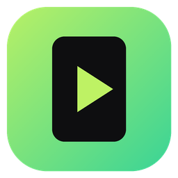
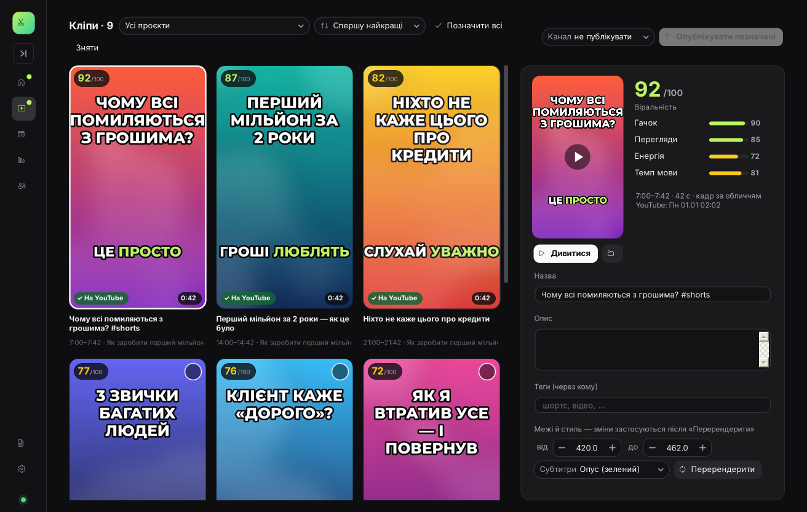
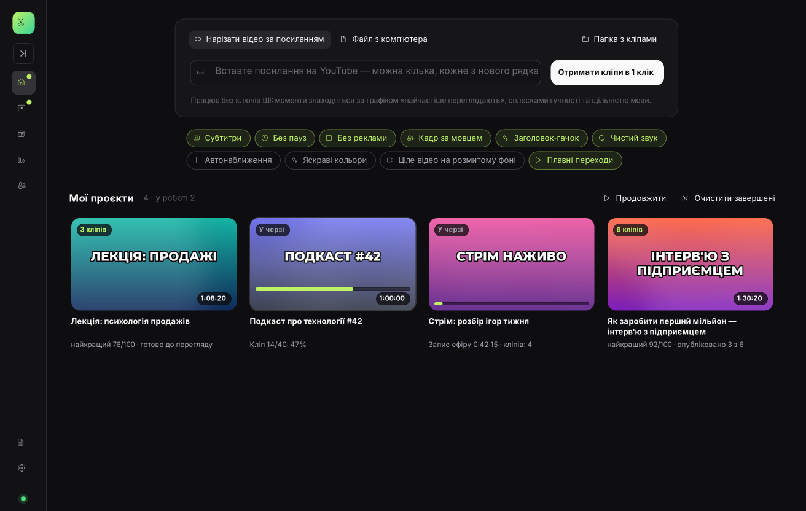
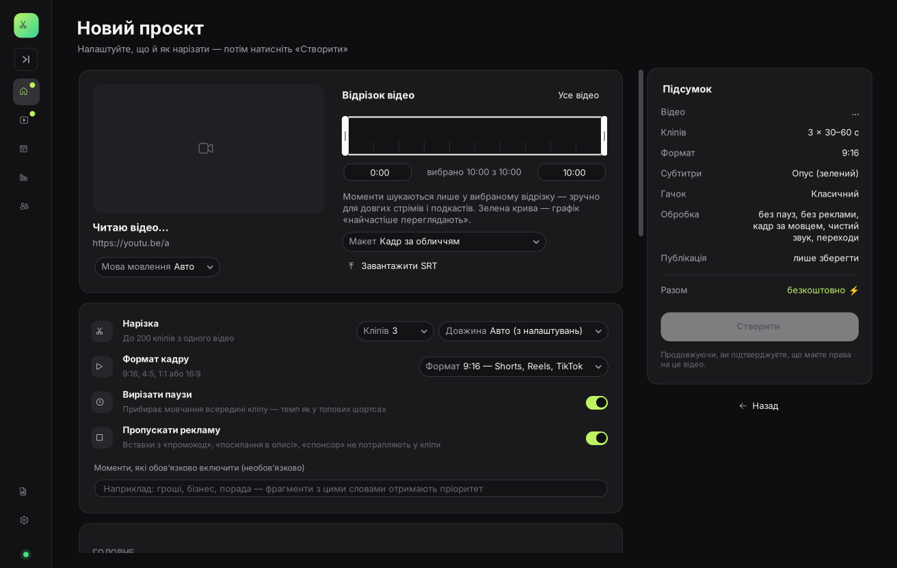
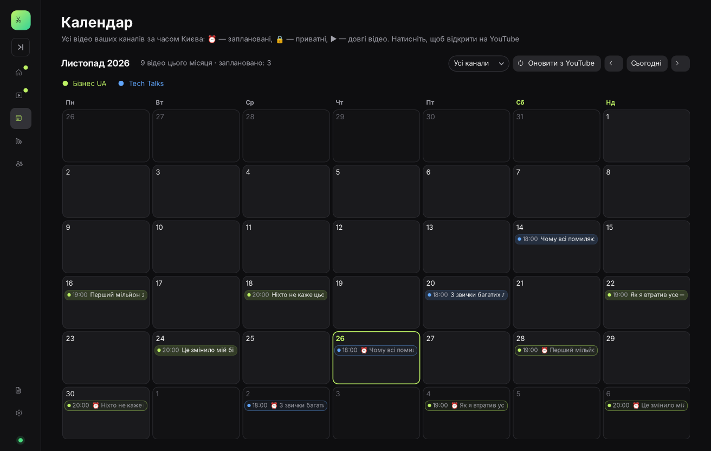
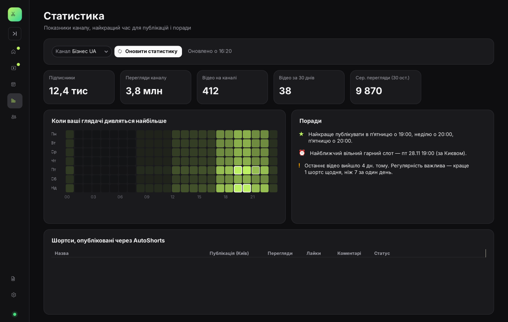
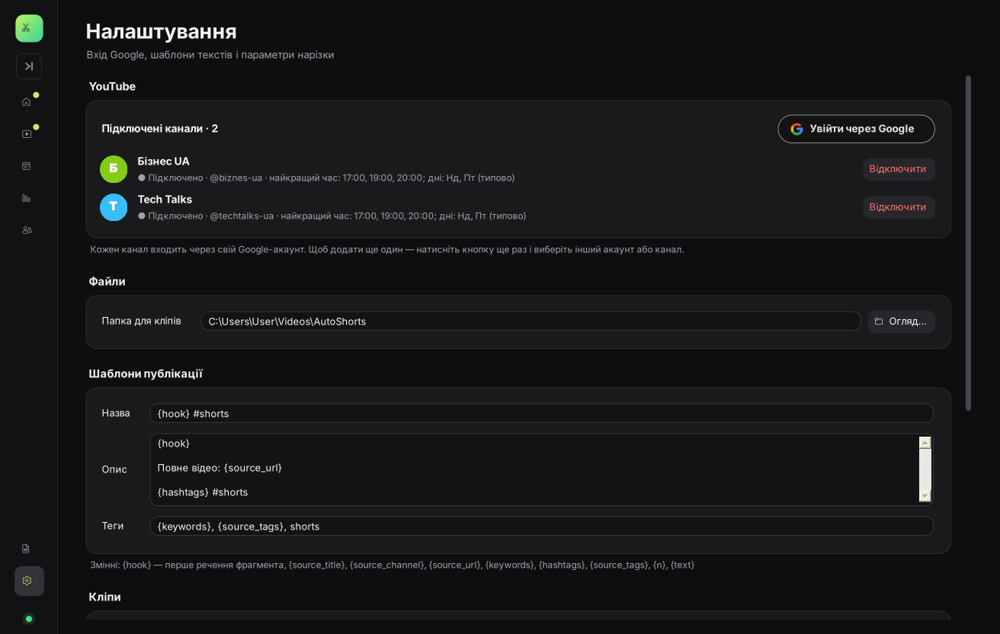

<div align="center">



# AutoShorts

**Довге відео → вірусні вертикальні шортси.**<br>
Подкасти, інтерв’ю, стріми й прямі ефіри — у готові Shorts, Reels і TikTok<br>
з кадром за мовцем, караоке-субтитрами й гачком. Сам публікує на YouTube у найкращий час.<br>
Усе працює на вашому комп’ютері: без ключів ШІ, кредитів і водяних знаків.

[](https://github.com/Dimonchikk/AutoShorts/actions/workflows/build.yml)
[](https://github.com/Dimonchikk/AutoShorts/releases/latest)
[](LICENSE)
[](https://github.com/Dimonchikk/AutoShorts/releases)
[](#встановлення)
[](#збірка)
[](#можливості)

### [⬇️ Завантажити останній реліз](https://github.com/Dimonchikk/AutoShorts/releases/latest) · [Встановлення](#встановлення) · [Можливості](#можливості) · [Збірка](#збірка) · [Сайт](https://dimonchikk.github.io/AutoShorts/)

<br>



</div>

---

## Знімки екрана

<table>
<tr>
<td width="50%"><br><b>Головна</b> — вставте посилання, проєкти в роботі й готові</td>
<td width="50%"><br><b>Новий проєкт</b> — відрізок, кількість кліпів, формат, обробка</td>
</tr>
<tr>
<td><br><b>Календар</b> — усі відео каналів, заплановані й опубліковані</td>
<td><br><b>Статистика</b> — теплова карта «день × година» і поради</td>
</tr>
<tr>
<td><br><b>Кліпи</b> — оцінка віральності, назва, перерендер</td>
<td><br><b>Налаштування</b> — вхід через Google, шаблони, обробка</td>
</tr>
</table>

## Можливості

**Пошук моментів**
- Графік YouTube «найчастіше переглядають», сплески гучності й щільність мови — без хмарного ШІ.
- Оцінка віральності 0–100 з розбивкою: гачок, перегляди, енергія, темп.
- Розумні межі: кліп починається й закінчується на реченні, без «ну, так от» і обірваних фраз.
- Пропуск реклами («промокод», «посилання в описі», «спонсор»).
- До **200 кліпів** з одного відео, довжина на вибір; можна вибрати відрізок на графіку переглядів.

**Кадр і обробка**
- Формати **9:16, 4:5, 1:1, 16:9**.
- Кадр за мовцем — рамка плавно їде за обличчям (детектор Windows).
- Макет **«Стрім»**: камера стримера зверху, гра знизу — знаходиться автоматично.
- Вирізання пауз, чистий звук −14 LUFS, автонаближення, переходи, логотип.
- Кодування на **відеокарті** (NVIDIA / AMD / Intel) і вибір потужності 25–100 %.

**Субтитри**
- По 2–4 слова з підсвіткою слова, що звучить, і ключових слів — у стилі OpusClip.
- 6 стилів, зокрема **караоке-заливка**; **29 шрифтів** з кирилицею.
- Положення (низ / центр / верх) і розмір; гачок-заголовок на початку.
- Автосубтитри YouTube, автопереклад або свій `.srt`.

**Публікація**
- Кілька YouTube-каналів, кожен через «Увійти через Google».
- Найкращий час за переглядами перших 48 годин ваших відео (інакше 17:00–22:00 за Києвом, пт і нд).
- Денний ліміт YouTube закінчився — решта кліпів завантажиться сама наступного дня.
- Календар з усіма відео каналів, статистика, теплова карта «день × година» і поради.
- **Прямі ефіри**: запис трансляції й нарізка кліпів по ходу, з автопублікацією.

## Встановлення

1. Завантажте **`AutoShorts-Setup.exe`** з [останнього релізу](https://github.com/Dimonchikk/AutoShorts/releases/latest) — він додасть ярлики на робочий стіл і в «Пуск» (права адміністратора не потрібні).<br>Або портативну версію **`AutoShorts.exe`**.
2. Якщо Windows попереджає про невідомого видавця: «Докладніше» → «Усе одно запустити».
3. При першому запуску програма сама завантажить FFmpeg і yt-dlp.
4. «Канали» → **Увійти через Google** — і можна публікувати.

Потрібно: Windows 10 або 11 (x64). Оновлення програма перевіряє сама.

## Як це працює

1. **yt-dlp** завантажує відео й автосубтитри YouTube з часом кожного слова.
2. Фрагменти шукаються за графіком переглядів, гучністю й мовою; межі — на кінцях речень.
3. **FFmpeg** кадрує під формат, вирізає паузи, накладає субтитри й гачок.
4. Назва, опис і теги — за шаблонами; обкладинка — з найяскравішого кадру з назвою.
5. Публікація через YouTube Data API із запланованим часом для кожного каналу.

## Збірка

```powershell
powershell -ExecutionPolicy Bypass -File src\build.ps1
```

Використовується вбудований у Windows компілятор C# (.NET Framework 4.x), результат — `dist\AutoShorts.exe`. Інсталятор збирається Inno Setup з `src\installer.iss`.

## Реліз

Версія — у `src/Version.cs`, опис змін — у [`CHANGES.md`](CHANGES.md) (розділ `## <версія>`). Workflow **Build** з потрібною версією збирає exe та інсталятор і створює чернетку релізу. Після публікації workflow **Telegram Release Post** надсилає пост у канал (секрети `TELEGRAM_BOT_TOKEN`, `TELEGRAM_CHAT_ID`). Вбудований вхід Google береться із секретів `GOOGLE_CLIENT_ID` і `GOOGLE_CLIENT_SECRET`.

## Ліцензія

[MIT](LICENSE) © 2026 Dmytro Brychnik. Шрифти в `fonts/` — під власними ліцензіями (SIL OFL 1.1, Apache 2.0), див. [`fonts/README.md`](fonts/README.md).

<div align="center">

[Політика конфіденційності](https://dimonchikk.github.io/AutoShorts/privacy.html) · [Умови використання](https://dimonchikk.github.io/AutoShorts/terms.html)

</div>
